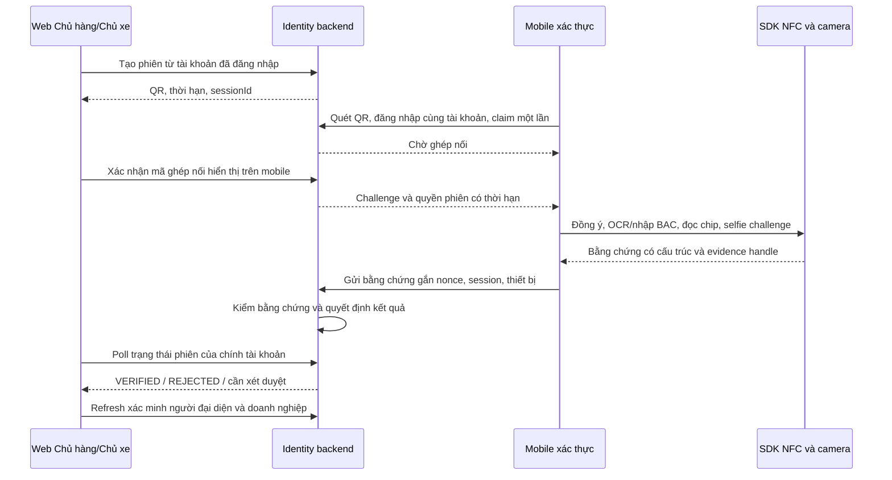

# Kế hoạch eKYC qua QR web và SDK NFC mobile

Ngày khảo sát: 2026-10-05–06. Các phần audit và bảng P0–P11 dưới đây ghi lại baseline/kế hoạch ban đầu. SDK Android, app chung, API phiên và QR web đã được hiện thực ở mức phát triển; trạng thái kiểm chứng và các gate còn thiếu xem [SDK_IMPLEMENTATION_PROGRESS.md](../../../../NFC/cccd-bac-android/docs/SDK_IMPLEMENTATION_PROGRESS.md). Chưa có xác nhận đọc CCCD trên thiết bị thật hay eKYC đạt điều kiện production.

**Cập nhật triển khai 2026-10-09:** QR web, app ghép phiên/NFC và API phiên đã tích hợp ở mức phát triển. VNPT UI, token frontend và API nhận kết quả từ client đã được gỡ; endpoint đọc trạng thái và dữ liệu eKYC lịch sử vẫn được giữ. Việc chuyển luồng không đồng nghĩa với xác nhận production: cần hoàn tất kiểm thử thiết bị thật, issuer trust và PAD.

## 1. Kết luận và phạm vi đã xác nhận

Người dùng yêu cầu Chủ hàng/Chủ xe bắt đầu xác minh người đại diện trên web, thấy QR, dùng mobile quét QR rồi đọc CCCD NFC và xác thực khuôn mặt. Backend quyết định kết quả và cập nhật web. Đây không phải tính năng nhận chuyến bằng PIN của Tài xế.

Đính chính phạm vi ngày 2026-10-06: **một app mobile dùng chung cho Chủ hàng, Chủ xe và Tài xế, có điều hướng/chuyển ngữ cảnh theo vai trò**. Tích hợp SDK và màn quét QR vào repo mobile hiện có `fe/backhaulbid-driver-app`; tên repo không giới hạn vai trò của sản phẩm. Không tạo app xác thực riêng. Phần dùng chung ba role là mục tiêu đã được người dùng xác nhận; chưa hiện thực trong checkout khảo sát.

Bản chi tiết redesign SDK/UI đã bổ sung ở [SDK_REDESIGN_PLAN.md](../../../../NFC/cccd-bac-android/docs/SDK_REDESIGN_PLAN.md), kèm [preview tương tác](../../../../NFC/cccd-bac-android/docs/redesign/preview.html). Tài liệu đó cụ thể hóa module/contract/lifecycle, từng màn/CTA/lỗi, manifest và các change set D/H/B/W/Q/R; dùng làm kế hoạch triển khai chi tiết thay các task SDK/UI lớn P2–P4/P9 dưới đây. Đây là thiết kế/preview, chưa thay runtime native hoặc tạo AAR.

**Khả thi để làm PoC Android. Chưa đủ điều kiện thay toàn bộ eKYC ở production ngay.** Lõi NFC và camera đã có, nhưng cần tách SDK, ghép phiên web/mobile, quyết định kết quả trên server, có trust anchor hợp lệ và kiểm thử thẻ/thiết bị thật. Không coi phát hiện tag, SELECT AID, đọc chip hoặc một boolean PASS từ app là đã xác minh danh tính.

Thay luồng xác minh người đại diện; giữ quy trình xác minh doanh nghiệp/MST, đối chiếu tên người đại diện và các kiểm duyệt giấy tờ khác. iOS là giai đoạn riêng, không thuộc PoC đầu.

## 2. Bằng chứng từ các repo

| Thành phần hiện tại | Có thể dùng lại | Khoảng trống cần xử lý |
|---|---|---|
| `NFC/cccd-bac-android`, chỉ có module `:app` | BAC `VN_BAC_LAST9`, secure messaging, đọc LDS, parser, kiểm hash DG/chữ ký SOD | Chưa là Android library/AAR; chưa có bridge Expo |
| `domain`, `crypto`, `protocol`, `lds`, `nfc` | Phần lớn lõi không phụ thuộc UI; Android ReaderMode/IsoDep | Tách dependency và lifecycle; giữ một lần EXTERNAL_AUTH mỗi phiên, không thêm fallback/bruteforce |
| `document` | CameraX, OCR/MRZ, chất lượng ảnh, kiểm chéo | UI và coordinator còn gắn app; OCR chỉ hỗ trợ nhập BAC và đối chiếu, không chứng minh giấy tờ thật |
| `biometric` | Challenge chớp mắt/quay đầu, passive liveness, face matching ONNX | Model chỉ ở `src/debug/assets`; release thiếu model; ngưỡng/FAR/FRR/PAD chưa được xác nhận |
| `lds/CmsSodVerifier.kt` | Kiểm CMS và hash dữ liệu | CSCA mặc định rỗng: `TRUST_NOT_ESTABLISHED`; cần nguồn trust anchor có thẩm quyền |
| `ui/demo/NfcResultBridge.kt` | Điểm xuất kết quả tham khảo | Bỏ đường legacy boolean và demo success khi tạo adapter production |
| `biometric/camera/BiometricResult.kt` | Kết quả có cấu trúc | `LIVE_DEVELOPMENT`/`MATCH_DEVELOPMENT` đang được quy thành PASS; không cho dùng để cấp VERIFIED |
| `ui/EkycUiPolicy.kt` | Chính sách UI tập trung | Release hiện cho chụp màn hình để trình diễn; SDK production cần chặn màn hình chứa PII |
| Đọc ảnh DG2 | JPEG | JPEG2000 chưa hỗ trợ; phải trả unsupported hoặc bổ sung decoder sau spike, không bỏ qua face match |
| `identity-service/.../EkycService.java` | Đọc trạng thái hồ sơ lịch sử | Đường POST nhận cờ kiểm tra từ client đã gỡ; session NFC là đường gửi kết quả hiện tại |
| `web/src/components/eKYC/{EkycModal,NfcEkycModal}.jsx` | Tạo QR, ghép phiên, refresh trạng thái | Đang dùng NFC; không có VNPT fallback |
| `fe/backhaulbid-driver-app` | App chung, quét QR và gửi kết quả capture | Đã có màn ghép QR/NFC cho xác thực người đại diện ở mức phát triển |

Kiểm tra local: `gradlew.bat --offline testDebugUnitTest assembleRelease` thành công. Kết quả unit test ban đầu lấy từ cache; đã chạy tiếp `--rerun-tasks --no-build-cache testDebugUnitTest`: **300 test, 0 fail/error/skip**, 26 task thực thi. APK unsigned release hiện 196,586,097 byte (~187.5 MiB), không đại diện cho kích thước SDK sau tách. Build thành công không chứng minh có model release hoặc đọc được thẻ thật. Tài liệu kiểm thử thẻ trong repo chưa cung cấp bằng chứng hoàn tất gate thiết bị thật.

## 3. Kiến trúc đề xuất

**Một app BackHaulBid cho cả 3 role**, phát triển tiếp trong `fe/backhaulbid-driver-app`. SDK Kotlin và bridge Expo Modules dùng chung trong app; SHIPPER/CARRIER có khu vực xác minh người đại diện với màn quét QR/NFC/selfie. DRIVER giữ luồng nhận chuyến bằng PIN, hành trình và bằng chứng giao hàng. Tabs/trang chủ/hành động được chọn theo vai trò có quyền trên backend; deep link cũng phải qua cùng route guard.

Chuyển vai trò là chuyển ngữ cảnh được backend cấp, không chỉ đổi một biến trên UI. Backend hiện có `Account.role` đơn và login trả một `role`: chưa thấy cơ chế một tài khoản sở hữu nhiều role trong phạm vi khảo sát. App có thể dùng chung cho ba loại tài khoản, nhưng để một tài khoản chuyển giữa nhiều vai trò cần membership và API chuyển ngữ cảnh phát credential tương ứng trên backend. Nếu chuyển giữa các tài khoản thì cần luồng đổi tài khoản rõ ràng. Kế hoạch phải chốt và triển khai contract này ở P0R/P4a; không cho client tự đặt role hay nâng quyền từ QR.

Khi chuyển ngữ cảnh/đăng xuất: hủy phiên NFC cục bộ, thu hồi phiên xác minh đang hoạt động theo policy, xóa cache và bằng chứng tạm, reset navigation; không để token/dữ liệu Chủ hàng hoặc Chủ xe rơi vào màn Tài xế. QR chỉ phục vụ eKYC khi ngữ cảnh hợp lệ là SHIPPER/CARRIER và cùng tài khoản sở hữu phiên web. Quét từ ngữ cảnh DRIVER phải hướng dẫn chuyển đúng ngữ cảnh, không tự nâng quyền.



Web chỉ hiển thị QR/trạng thái. Web NFC hỗ trợ NDEF, không cung cấp ISO-DEP/APDU cần cho BAC: [Chrome Web NFC](https://developer.chrome.com/docs/capabilities/nfc). Expo SDK 54/RN 0.81 là baseline host khảo sát, không nâng framework trong spike: [Expo 54](https://docs.expo.dev/versions/v54.0.0/). SDK native phải dùng development build hoặc app build riêng: [Expo custom native code](https://docs.expo.dev/workflow/customizing/).

Android core hiện minSdk 26: bản Android tích hợp SDK cần Android 8+; thiết bị phải có NFC để chạy bước đọc chip. App chung vẫn phải có trạng thái không hỗ trợ NFC rõ ràng. Cần thử tương thích AGP/Kotlin/Compose/CameraX/ONNX với native project Expo thật. `expo export -p web` không xác nhận bridge NFC hoạt động.

iOS hỗ trợ giao tiếp ISO7816 qua [Core NFC](https://developer.apple.com/documentation/corenfc/nfciso7816tag), nhưng AAR Kotlin hiện tại không chạy trên iOS. Cần adapter Swift, tái hiện protocol, entitlement, camera/model pipeline, macOS/Xcode và iPhone thật trước khi cam kết iOS.

## 4. Ranh giới SDK và contract

Tách trước thành `:nfc-core` (protocol/crypto/LDS/parser, không Android UI), `:ekyc-android` (reader/camera/OCR/biometric/flow, Android library) và giữ `:app` làm sample kiểm chứng. Chỉ tách biometric thành module riêng nếu số đo dependency/kích thước cho thấy cần; không tạo quá nhiều package ban đầu.

SDK offline: không tự tạo phiên web, đăng nhập, gọi backend, chọn URL upload hay quyết định VERIFIED. Quyền mạng thuộc host app. Module Expo chuyển lệnh, tiến độ và mã lỗi; dữ liệu CCCD/selfie không chuyển thành JSON/base64 lớn qua JS hoặc Intent.

```ts
type VerificationStep = 'DOCUMENT' | 'NFC' | 'LIVENESS' | 'UPLOAD';
type LocalCheck = 'PASS' | 'FAIL' | 'UNAVAILABLE';
type LocalResult = {
  outcome: 'CAPTURED' | 'CANCELLED' | 'FAILED';
  evidenceHandle?: string; // opaque, short-lived; native giữ dữ liệu
  checks?: { dgHashes: LocalCheck; sodSignature: LocalCheck;
             issuerTrust: LocalCheck; liveness: LocalCheck; faceMatch: LocalCheck };
  errorCode?: string;
};
// start(context chứa sessionId, challenge, expiresAt, policyVersion), cancel(), dispose()
// progress chỉ chứa step/trạng thái; upload bằng host native adapter tới endpoint allowlist
```

`CAPTURED` nghĩa là đã thu bằng chứng, chưa phải đã xác thực. Handle chỉ dùng một phiên, không persist qua app restart. Mặc định giữ trong bộ nhớ; nếu cần file tạm cho upload phải dùng storage private mã hóa, giới hạn TTL và xóa khi thành công/hủy/hết hạn. Chính sách mới này phải được ghi rõ trước khi thay quy tắc SDK hiện tại không persist dữ liệu thẻ.

Mã lỗi tối thiểu: `NFC_UNAVAILABLE`, `NFC_DISABLED`, `CAMERA_DENIED`, `QR_EXPIRED`, `QR_ALREADY_USED`, `ACCOUNT_MISMATCH`, `TAG_LOST`, `BAC_INPUT_INVALID`, `CARD_UNSUPPORTED`, `PORTRAIT_UNSUPPORTED`, `MODEL_UNAVAILABLE`, `ISSUER_TRUST_UNAVAILABLE`, `LIVENESS_FAILED`, `FACE_MISMATCH`, `UPLOAD_RETRYABLE`. Không chứa số CCCD/APDU/dữ liệu ảnh trong lỗi.

Host phải xử lý activity recreation/background/cancel, camera đóng trước reader, ReaderMode chỉ khi foreground, session hết hạn trong lúc quét, thao tác gửi lặp và mạng gián đoạn.

## 5. API và trạng thái phiên đề xuất

API dưới `identity-service`, qua gateway hiện tại; account/role lấy từ xác thực server. Tên route bên dưới là thiết kế, chưa có trong repo.

| API | Auth/phạm vi | Hành vi |
|---|---|---|
| `POST /api/v1/representative-verification-sessions` | SHIPPER/CARRIER | Tạo session và QR token; idempotency key chống tạo lặp; phiên mới hủy phiên cũ đang hoạt động theo policy |
| `GET /.../{sessionId}` | Chủ sở hữu | Status, expiresAt, bước an toàn, kết quả tóm tắt; không trả token/evidence |
| `POST /.../{sessionId}/pair` | Mobile cùng tài khoản + QR token | Consume QR bằng atomic compare-and-set; gắn public key thiết bị, sinh pairing code |
| `POST /.../{sessionId}/approve` | Web chủ sở hữu | Xác nhận pairing code; cấp challenge/quyền upload chỉ cho thiết bị đã ghép |
| `POST /.../{sessionId}/evidence` | Token phiên có scope + chứng minh giữ device key | Upload multipart/stream giới hạn loại/dung lượng; nonce, evidence digest, policy/model version; idempotent; kiểm TTL và state |
| `DELETE /.../{sessionId}` | Chủ sở hữu | Hủy phiên, thu hồi quyền, xóa evidence theo policy |

QR là HTTPS verified app link trên domain đã kiểm soát; chứa sessionId và token ngẫu nhiên entropy cao, không chứa JWT tài khoản/PII. Không chỉ dùng custom scheme cho production vì app khác có thể nhận scheme. Token hash lưu ở server, thời hạn đề xuất 5 phút để ghép; sau ghép cửa sổ thu bằng chứng đề xuất 10 phút. Đây là giá trị thiết kế cần đo lại qua test người dùng. Không ghi QR token vào access log/analytics/history; landing page không tải analytics/third-party, có no-store/referrer-policy, token đặt trong fragment nếu triển khai landing bridge. App chỉ nhận đúng host/path/format; không mở URL từ QR tùy ý. [Expo linking](https://docs.expo.dev/linking/into-your-app/).

Mọi credential scoped chỉ cấp sau chủ web xác nhận; mobile cùng account login là bắt buộc trong bản đầu. Bị chụp QR không đủ để xác thực thay người khác. Pairing/device key là ràng buộc phiên, không chứng minh SDK chưa bị chỉnh sửa.

Session state: `CREATED → PAIRING → PAIRED → SUBMITTED → VERIFYING → VERIFIED | REJECTED | PENDING_MANUAL_REVIEW`; các bước trước submit có thể `CANCELLED | EXPIRED`. Trạng thái từng bước NFC/selfie từ mobile là thông tin UX không đáng tin cậy. Không để client chọn terminal state. Lock/version/CAS chống claim/approve/upload lặp và race hết hạn/cancel; không giữ transaction DB trong lúc chạy inference.

Polling 2–3 giây cho PoC, backoff khi offline, dừng khi đóng modal/terminal; owner check mỗi GET. Chưa cần thêm SSE nếu chưa có nhu cầu. DB session có ownerAccountId/role, tokenHash, deviceKeyFingerprint, nonce, expiresAt, status/version, policyVersion, evidenceRef/digest và decisionReason. Chọn số migration khi triển khai bằng cách kiểm tra lịch sử **identity-service**, không dùng V21 theo số contract-service.

## 6. Quyết định trên backend và an toàn dữ liệu

Điều kiện VERIFIED: phiên hợp lệ và đúng chủ sở hữu; đủ bằng chứng; parse hạn mức; hash DG khớp SOD; chữ ký SOD hợp lệ; chain đến CSCA tin cậy theo policy; thẻ còn hạn; danh tính chip nhất quán; liveness và face match đạt policy được kiểm chứng trên server hoặc dịch vụ tin cậy; không có development override. Sau đó mapper cập nhật EkycVerification và CompanyVerificationService đối chiếu đại diện như hiện tại.

Server tự tính hash/chữ ký/trust từ bằng chứng, không tin `sodPassed=true` từ mobile. DG1/DG2/EF.SOD là tập ban đầu cho kiểm chip; chỉ lấy DG13 nếu parser và nghiệp vụ xác định cần. Liveness cần chuỗi ảnh/video challenge và score/inference đáng tin cậy, không chỉ gửi ảnh selfie đơn. Bind manifest, nonce, device key và policy version; digest chống tráo các phần upload; limit thời lượng/frame/dung lượng và parser trước inference.

**SOD là bằng chứng tĩnh.** Nonce của phiên chống replay request nhưng không khiến SOD chứng minh chip đang ở cạnh điện thoại hoặc chứng minh chip không bị clone. Device attestation là tín hiệu rủi ro bổ sung, không thay trust chain/liveness. PoC không được quảng bá tương đương cơ chế xác thực chip động hay chống mọi giả mạo.

Thiếu CSCA/model hoặc backend biometric chưa sẵn sàng: giữ `PENDING_MANUAL_REVIEW` của session, mapping entity hiện tại về PENDING, hoặc chuyển provider fallback đã được backend kiểm chứng. Không đánh VERIFIED rồi mới bổ sung kiểm tra sau.

Đường legacy `POST /api/v1/representative-verifications` nhận boolean từ client đã bị gỡ; endpoint GET trạng thái vẫn tồn tại để đọc hồ sơ cũ. Không giữ provider fallback. Kết quả NFC vẫn phải qua policy phía máy chủ; không tự nâng cấp hồ sơ cũ. Xác định chính sách kết quả cũ và re-verification với người vận hành.

CSCA cần provenance, ngày hiệu lực, policy cập nhật/thu hồi và certificate rollover; không chọn một certificate do app gửi làm trust root. Model release cần nguồn/license/hash/version, PAD test và ngưỡng FAR/FRR dựa trên dữ liệu đánh giá phù hợp. Không chép model debug sang release rồi mặc định an toàn.

Production: `FLAG_SECURE` cho mọi màn có CCCD/selfie; allowBackup=false; không log CCCD/ngày sinh/MRZ/UID/APDU/keys/raw DG/ảnh/QR/token. SDK core giữ không INTERNET; kiểm merged manifest sau tách. Upload TLS chỉ endpoint allowlist của host; URL evidence private có TTL, không public bucket; storage server mã hóa, quyền truy cập tối thiểu, retention và lịch xóa rõ ràng. S3 local đang đọc 403: cần đường private upload/download server hợp lệ, không sửa bằng public-read cho ảnh danh tính. UI phải xin đồng ý rõ về dữ liệu gửi server và thời gian lưu trước capture.

## 7. Màn hình và hành vi

- Web: modal QR có hướng dẫn cài app/Android NFC, thời hạn, trạng thái ghép, mã xác nhận, hủy/tạo lại. Khi dùng web trên chính điện thoại có nút mở app thay vì buộc quét màn hình của mình. Chỉ hiện “Đã xác minh” sau kết quả server; tách “Đã đọc chip”, “Đang xử lý”, “Cần xét duyệt”.
- Mobile chung: đăng nhập/chuyển sang ngữ cảnh SHIPPER hoặc CARRIER được backend cấp → quét QR → xác nhận phiên và chờ web approve → đồng ý → OCR/nhập BAC có kiểm tra → hướng dẫn vị trí NFC và retry tag lost → selfie challenge → upload → kết quả server. Giữ input BAC trong bộ nhớ, xóa khi đóng phiên. DRIVER vẫn có navigation/hành động chuyến riêng trong cùng app.
- Thiết bị không NFC/iOS chưa hỗ trợ, thẻ ngoài profile, JPEG2000, model thiếu: hướng dẫn thay thiết bị/provider hoặc xét duyệt; không giả thành công. Card/date sai không tự thử nhiều profile/khóa.
- Đóng modal/cancel/restart: phiên server bị thu hồi; mobile nhận lỗi typed, không tiếp tục upload vào phiên cũ. Upload đã tới server nhưng mất response phải truy vấn/retry idempotent, không tạo xác minh trùng.

## 8. Các việc triển khai theo thứ tự

Mỗi dòng là một change set review được; chia nhỏ thêm nếu tách SDK làm thay nhiều file. Ưu tiên đóng rủi ro/kiểm phần cứng trước làm toàn bộ UI.

| # | Thay đổi chính và vùng file | Phụ thuộc | Tiêu chí hoàn tất / kiểm chứng |
|---|---|---|---|
| P0 | ADR + inventory: `NFC/docs`, contracts session/result, baseline manifest/model/license | — | Chốt phạm vi Android, privacy/trust policy, snapshot test/build; không thay protocol |
| P0R | Contract app chung/role context: kiểm `lib/auth.js`, `app/_layout.jsx`, tabs và backend Account/auth | — | Chốt mô hình chuyển tài khoản hay membership nhiều role; mọi ngữ cảnh phải có credential server hợp lệ; ma trận route/API cho 3 role |
| P1 | Sample chạy thẻ thật bằng flow hiện tại; ghi evidence đã che PII | P0 | BAC/read DG1/DG2/SOD, camera trên ít nhất 2 Android NFC; xác nhận profile/JPEG của thẻ, tag lost; gate thất bại thì dừng cam kết NFC replacement |
| P2 | `settings.gradle.kts`, core module build, package protocol/crypto/LDS + test | P1 | JVM tests pass sau chuyển, API Android-free; app sample vẫn build; không đổi bytes APDU |
| P3 | Android library, reader/flow/UI adapter; bỏ demo boolean/development PASS và chỉnh screen policy | P2 | Sample dùng SDK thật; cancel/background/rotate sạch; release thiếu model trả lỗi; kiểm manifest/log/FLAG_SECURE |
| P4a | Auth/role context và navigation app chung trong repo hiện tại; triển khai thành các change set auth/backend, route guard, UI switcher | P0R | SHIPPER/CARRIER/DRIVER đăng nhập vào đúng màn; chuyển ngữ cảnh đúng contract server; reset cache/navigation; deep link không vượt quyền; không mở hành động tài xế cho role khác |
| P4b | Expo native module/config plugin trong `backhaulbid-driver-app` | P3, P4a | Development build chạy trên điện thoại thật, nhận typed result/cancel; compile SDK/AGP/Kotlin dependencies hòa hợp; đo APK/ABI; route NFC chỉ SHIPPER/CARRIER |
| P5 | Identity entity/repository/DTO/migration + session service/controller | P0 | Unit + DB integration tests TTL/owner/role, one-time pair, same-account, approve, atomic races, idempotency; không trust client state |
| P6 | Bằng chứng upload/parser, CSCA verifier và decision service | P5 | Fixtures chữ ký/hash sai, certificate tự ký/không tin, thiếu DG, expired card, quá dung lượng đều không VERIFIED; cấp quyền session scoped |
| P7 | Backend liveness/face matching adapter và model policy | P6 | Legacy POST đã bị gỡ; server không dùng development score để chứng nhận production; giữ CompanyVerificationService rules |
| P8 | `web/components/eKYC/EkycModal.jsx`, QR panel + session API client | P5 | SHIPPER/CARRIER cùng flow, stale QR/cancel/pair mismatch/poll retry, mobile mở app; 360–1440px, focus/keyboard |
| P9 | Màn QR/pair/eKYC trong app chung + SDK capture/native upload adapter | P4b, P5, P6 | Login same account, deeplink allowlist, web approve, camera/NFC permissions và upload idempotent; không PII/token trong JS log; chuyển ngữ cảnh hủy capture an toàn |
| P10 | E2E và fault tests; evidence checklist + size/latency baseline | P7, P8, P9 | SHIPPER/CARRIER web QR → app chung → server → refresh company; DRIVER nhận chuyến PIN không hồi quy; role switching/deep link không vượt quyền; reject/replay/timeout/network/missing model; release artifact thật |
| P11 | Feature flag/canary, fallback và hướng dẫn vận hành | P10 | Flag theo account/cohort; không có đường boolean bypass; metric không PII; rollback về phương án server kiểm chứng/xét duyệt, xử lý phiên đang chạy rõ ràng |

P0/P1 là checkpoint phần cứng và SDK contract. Kế hoạch ban đầu này đã được thay bằng triển khai NFC ở mức phát triển; VNPT đã được gỡ theo quyết định sản phẩm. Chưa xác nhận đọc CCCD trên thiết bị thật hay đạt yêu cầu production trust/PAD.

## 9. Gate khả thi và nghiệm thu

| Gate | Bằng chứng bắt buộc | Hiện tại |
|---|---|---|
| Android protocol | Thẻ thật, thiết bị thật, hash/read failure policy | Chưa xác nhận |
| SDK host | AAR/module chạy trong Expo development build native | Đã tách/publish SDK, compile bridge và build APK debug x86_64; chưa nghiệm thu cài/chạy trên thiết bị thật |
| Production models | Release asset/provenance/license và đánh giá PAD/FAR/FRR | Chưa đủ |
| Trusted issuer | CSCA nguồn tin cậy, policy cập nhật/thu hồi | Chưa có anchor mặc định |
| Backend trust | Server quyết định, legacy boolean không bypass | Đường legacy boolean đã gỡ; còn thiếu trusted issuer/PAD mức production |
| Web/mobile security | Same account + approve, QR expiry/one-use/replay/IDOR tests | Đã có API phiên, unit test và kiểm gateway/browser bằng dữ liệu tổng hợp; còn ma trận lỗi thiết bị/network |
| Privacy/operations | Đồng ý, private evidence, xóa dữ liệu, no logs/screenshots | Native RAM/TTL/FLAG_SECURE và server xử lý RAM đã có; còn contract consent/policy đầy đủ, retention job và nghiệm thu lifecycle |
| iOS | Native adapter và test iPhone | Ngoài PoC đầu |

Ước lượng nội bộ, không phải cam kết: spike thiết bị/SDK host 3–5 ngày công nếu có Android NFC/thẻ hợp lệ; phần PoC QR + SDK + backend session thêm khoảng 10–15 ngày công, chưa tính hoàn thiện app chung/role context. Cần ước lượng P4a sau khi chốt contract P0R, đặc biệt nếu một tài khoản có nhiều role. Thời gian lấy CSCA hợp lệ, đánh giá biometric, quyền sử dụng model và mở rộng iOS chưa thể chốt từ repo. Prototype chỉ thu bằng chứng/chờ xét duyệt nhanh hơn một hệ thống tự động cấp VERIFIED đủ các gate.

Quyết định đề xuất: **GO cho spike Android và PoC có kết quả trung thực; NO-GO cho bỏ hẳn eKYC hiện tại ngay lúc này.** Khi tất cả gate production đạt, chuyển QR/NFC làm mặc định và thu hồi đường cũ theo rollout có kiểm soát.
